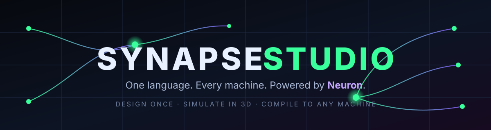
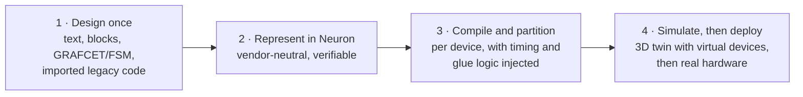
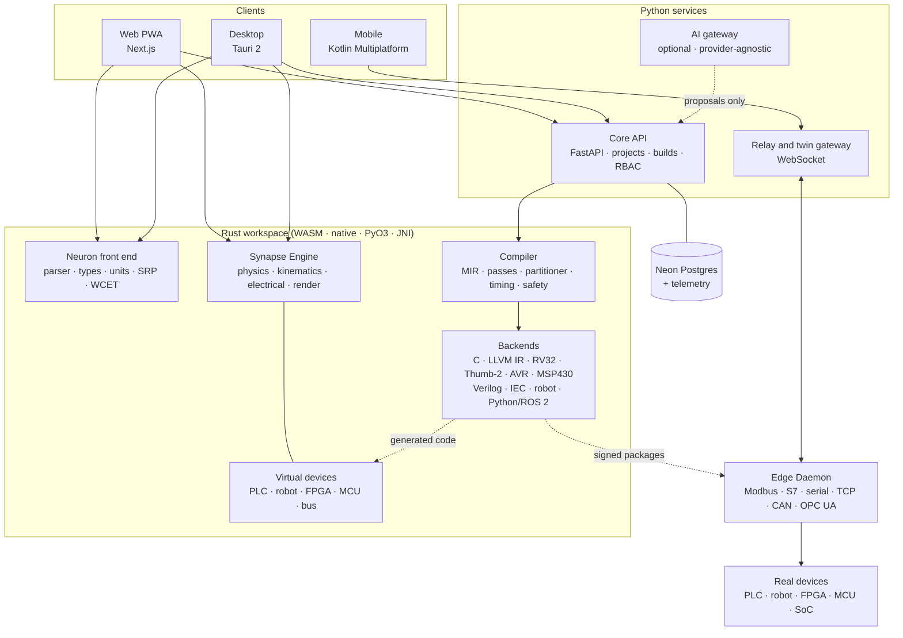
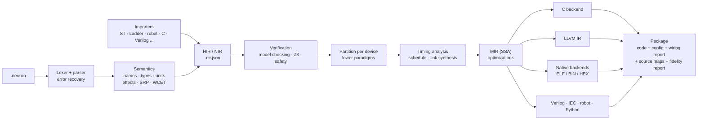
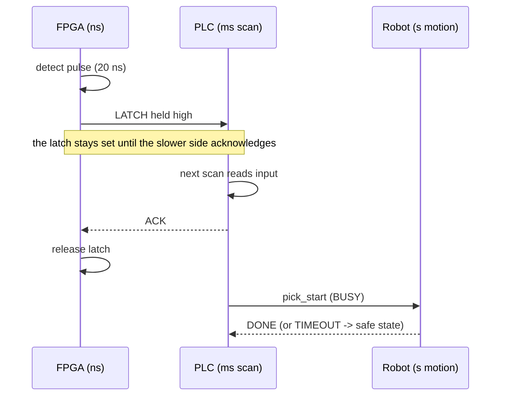
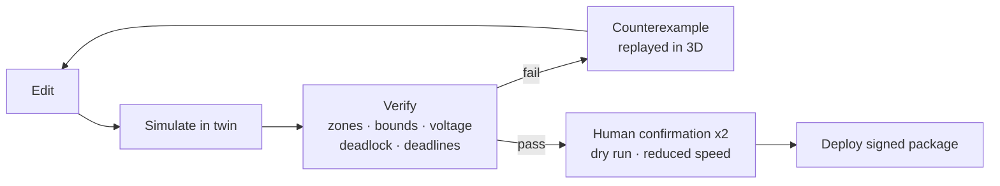
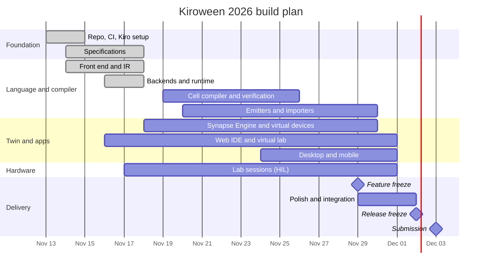

<p align="center">
  
</p>

<p align="center">
  <a href="https://github.com/HCHAPS404/Synapse-Studio/actions/workflows/ci.yml"></a>
  <a href="LICENSE"></a>
  
  
  
  
</p>

<p align="center">
  <b>Design once. Simulate in 3D. Compile to any machine.</b>
</p>

---

> **Project status: early development.** SYNAPSE Studio is being built in public
> during the Kiroween 2026 submission period (30 October to 4 December 2026). This
> README describes the full design. The [Status and roadmap](#status-and-roadmap)
> section states exactly what works today and what is planned. Nothing below marked
> *Planned* should be read as an existing feature.

## Table of contents

- [What is SYNAPSE Studio?](#what-is-synapse-studio)
- [The problem](#the-problem)
- [The solution: one language, many targets](#the-solution-one-language-many-targets)
- [Neuron, the language](#neuron-the-language)
- [Architecture](#architecture)
- [The compiler pipeline](#the-compiler-pipeline)
- [The Standard Time Model](#the-standard-time-model)
- [Safety and verification](#safety-and-verification)
- [Synapse Engine and the digital twin](#synapse-engine-and-the-digital-twin)
- [Virtual lab for judges (no hardware needed)](#virtual-lab-for-judges-no-hardware-needed)
- [Supported devices](#supported-devices)
- [AI: optional, never in the safety path](#ai-optional-never-in-the-safety-path)
- [Client applications](#client-applications)
- [Technology stack](#technology-stack)
- [Repository layout](#repository-layout)
- [Getting started](#getting-started)
- [How we build with Kiro](#how-we-build-with-kiro)
- [Status and roadmap](#status-and-roadmap)
- [Contributing](#contributing)
- [Safety notice](#safety-notice)
- [License and trademarks](#license-and-trademarks)

## What is SYNAPSE Studio?

SYNAPSE Studio is a software-defined industrial automation framework. Its center is
**Neuron**, a new programming language and canonical intermediate representation (IR).

With Neuron you write the logic of a machine, or of a whole manufacturing cell, once.
SYNAPSE Studio then:

1. **Compiles it directly to devices.** It produces native firmware for
   microcontrollers, without an RTOS and without vendor IDEs in the loop.
2. **Translates between ecosystems.** It imports existing PLC, robot, HDL, C and
   Python code into Neuron and emits the native language of each target device.
3. **Verifies before anything is energized.** It checks shared-zone exclusion, robot
   workspace bounds, voltage compatibility, timing budgets and state-machine
   properties.
4. **Simulates everything in a digital twin.** The twin is a from-scratch 3D engine
   whose virtual PLCs, robots, FPGAs and MCUs run the *generated code itself*.
5. **Deploys to real hardware** through a local Edge Daemon. Cells can be supervised
   from web, desktop and mobile apps.

## The problem

A real manufacturing cell or university lab rarely comes from a single vendor. One
line can combine a PLC from one brand, a pneumatic bench driven by a PLC from
another, a 6-axis robot arm, FPGA boards for high-speed logic and microcontrollers
for monitoring. Integrating them has five recurring costs:

| Barrier | What it means in practice |
|---|---|
| **Fragmented tools and languages** | Engineers juggle more than eight proprietary environments and languages (Ladder/SCL, Structured Text, robot languages, Verilog/VHDL, C/C++, Python/ROS). |
| **Hand-written glue logic** | Much of the integration time goes into mapping Modbus registers, PLC data blocks, TCP sockets and UART frames, just so two machines from different vendors can exchange a confirmation signal. |
| **Clashing time domains** | An FPGA switches in nanoseconds, a PLC scans in milliseconds, and a robot finishes a trajectory in seconds. Without formal hold-and-acknowledge mechanisms, fast pulses are lost. |
| **Physical and electrical risk** | Independent programs are not cross-checked, so collisions in shared zones are possible. Wiring 3.3 V logic to 24 V industrial I/O can destroy boards. |
| **Vendor lock-in and cost** | Closed, expensive or discontinued software keeps small companies and labs from modernizing machinery that still works. |

## The solution: one language, many targets

<p align="center">
  
</p>

The workflow has four stages:



**Example.** Consider this rule: *"when the optical sensor detects a bottle, run the
capping cycle, move the part with the robot to the press and fire the pneumatic
cylinder."* You write it once. From that single source, SYNAPSE Studio generates:
- the PLC program for the capping station,
- the robot program,
- the Structured Text for the pneumatics PLC,
- the Verilog or C++ for the FPGA or microcontroller,
- the synchronization messages between all of them.

Neuron supports two kinds of translation:

- **Porting logic.** The same program moves to another host, for example from one
  MCU to another, or from Ladder to Structured Text.
- **Bridging master and slave.** "Control the robot from the FPGA" does not mean
  turning robot code into Verilog. Neuron emits an FPGA master program and a robot-side
  command interpreter, joined by a verified link.

Every import and emission produces a **fidelity report** that lists what translated
exactly, what was approximated and what has no equivalent on the target.

## Neuron, the language

Neuron is a full programming language as well as an IR. It has two levels in one
syntax:

- **`module` (code level):** the program of a single device, down to bare-metal
  microcontrollers.
- **`cell` (system level):** devices, links, shared zones, sequences and safety rules
  for a whole cell.

> The syntax below is the **edition 2026 draft** defined in the
> [language specification](spec/language/README.md) (v0.4). It is not frozen yet.
> Both programs are copied from [`examples/`](examples/), which CI analyzes on every
> commit.

**A PID thermostat on a bare-metal MCU** ([`examples/thermostat.neuron`](examples/thermostat.neuron))

```python
module thermostat for mcu on nucleo_f446re

use std.control.{pid, lowpass}

const target = 60 degC

io sensor: adc(resolution: 12)  @ ADC1.in0(PA0)
io heater: pwm(freq: 1 kHz)     @ TIM2.ch2(PA1)
io alarm:  gpio.output          @ PA5

signal temp: f32 degC

let filter = lowpass(cutoff: 2 Hz)
var ctl = pid(kp: 2.0, ki: 0.1, out: 0..100 %, antiwindup: true)

task measure every 10 ms (prio 3):
  temp = sensor.read() |> scale(0..4095 -> 0..120 degC) |> filter.step()

task control every 100 ms (prio 2, deadline 20 ms):
  heater.duty = ctl.step(target - temp)

safety:
  watchdog 50 ms
  safe_state:
    heater.duty = 0 %
    alarm.write(true)
  when temp > 90 degC:
    fault Overheat
```

**A heterogeneous bottling cell** ([`examples/bottling_line.neuron`](examples/bottling_line.neuron))

```python
cell BottlingLine
  device ctl:  nucleo_f446re          @ usb
  device plc:  generic_s7_1200        @ ip(192.168.0.10)
  device arm:  generic_scara          @ ip(192.168.0.20)
  device fpga: generic_artix7_board   @ uart(COM4, 115200 Bd)

  place thermostat on ctl
  place conveyor on plc

  event bottle_seen: timestamp, encoder: u32 from fpga

  link fpga.bottle  -> plc.sensor  via zero_hop(gpio, opto_24v) within 15 ms
  link plc.cap_done -> arm.pick    via modbus_tcp every 10 ms within 25 ms

  tag line_speed: f32 mm/s @ plc.%MD20, ctl.speed

  zone press: box(x: 100..220 mm, y: -40..40 mm, z: 0..120 mm)
  mutex press between arm, plc.press_cylinder

  sequence Cycle on plc:
    initial step Idle:
      until plc.sensor.rising
    step Cap:
      run plc.capper.cycle()
      until plc.capper.done timeout 3 s -> Fault
    step Move:
      run arm.pick_and_place(from: conveyor_track(bottle_seen), to: press)
      until arm.done timeout 5 s -> Fault
      -> Idle
    step Fault:
      fault CycleFault
```

<sub>Code blocks use Python highlighting only because GitHub has no Neuron grammar
yet. A TextMate grammar and a VS Code extension are planned.</sub>

### Design principles

| Area | Decision |
|---|---|
| **Syntax** | New, indentation-based and readable. Pipelines `\|>`, arrows `->`, placement `@`, ranges `a..b`, named arguments. Not a copy of C, Rust or Python. |
| **Physical units** | Units are part of the type system (`5 ms`, `24 V`, `120 mm`, `60 degC`). `mm + ms` is a compile error (`NE0201`). |
| **Memory** | Static by default. No garbage collector and no implicit heap. `pool<T, N>` for fixed-capacity allocation. Stack depth is computed per task. |
| **References** | No raw pointers. Shared-read or exclusive-write references, checked at compile time. |
| **Concurrency** | Periodic, event and interrupt tasks with static priorities. The Stack Resource Policy (priority ceiling) guarantees no data races and no deadlocks. |
| **Real time** | Bounded loops. WCET (worst-case execution time) is estimated per task and checked against its declared `deadline`. |
| **Reactive constructs** | `fsm`, `sequence` (GRAFCET/SFC), `when … for 200 ms`, `every 10 ms`, `on event`. Async actions expose BUSY/DONE/TIMEOUT. |
| **Hardware** | Typed registers generated from CMSIS-SVD, per-architecture `asm` blocks and `extern "C"`. |
| **Abstraction** | `struct`, `enum` with payloads, `class` (also IEC function blocks), interfaces, static-dispatch generics, `Option`/`Result` (no exceptions). |
| **Contracts** | `requires`, `ensures`, `invariant` and `deadline`, checked by the verifier. |
| **Dialects** | `core`, `mcu`, `plc`, `hdl`, `robot`, `ui`, `host` and `cell`, declared in each file header. Each dialect restricts the legal constructs and explains why (`NE0501`). |

### File formats

| File | Purpose |
|---|---|
| `.neuron` | Source code, written by people and versioned in git. |
| `.nir.json` | Canonical IR for interchange between tools ([spec chapter 16](spec/language/16-nir.md)). Validated with the JSON Schema [`spec/schemas/nir.schema.json`](spec/schemas/nir.schema.json). |
| `.layout.json` | Diagram positions, kept separate so moving a block does not touch the logic diff. |
| `.scene.json` | Digital-twin scene. |
| `.target` | Architecture and board description (ISA, ABI, memory map, peripherals). |
| `neuron.toml` / `neuron.lock` | Package manifest and lockfile. |

### Standard library (planned)

`core` · `units` · `hal` · `logic` (IEC timers, counters, edge detection, GRAFCET runtime) ·
`control` (PID, IIR/FIR/Kalman filters, ramps, hysteresis) · `motion` (kinematics,
interpolators, stepper/servo profiles, G-code) · `proto` (Modbus RTU/TCP, CAN/CANopen,
MQTT, CRC, CBOR, SCPI, minimal OPC UA) · `dsp` · `drivers` (IMUs, temperature, load
cells, displays, encoders and more) · `safety` · `time` · `diag` · `test` · `bsp`.

## Architecture



The architecture separates two planes:
- **Supervision plane:** web, desktop and mobile apps connected by WebSockets.
- **Control plane:** deterministic and local. Once deployed, logic runs inside each
  device. If a tablet turns off or Wi-Fi drops, the cell keeps operating safely.

When two nearby devices need a microsecond response, the compiler can assign a
**zero-hop** link (GPIO, UART or CAN) so the signal does not pass through a computer.

## The compiler pipeline



Device code has three backend tiers:

1. **C backend.** Portable, uses each vendor toolchain. Covers every MCU from day one.
2. **LLVM IR backend** (textual), compiled with `clang`/`llc`/`lld`.
3. **Native backends with no external dependencies.** Instruction selection, register
   allocation, assembler and linker, for RV32IMC, ARM Thumb-2, AVR and MSP430.

Each generated line keeps a **source map** back to its `.neuron` line and diagram
element. This is what lets the inspector highlight the running line during
simulation.

## The Standard Time Model

Devices that work together must agree on time. Neuron defines one time model for the
whole cell:



- **Cell clock:** a base tick with per-domain multiples (ns FPGA, µs MCU/ISR,
  ms PLC and buses, s robot).
- **Logical execution time (LET):** inputs are sampled at the start of a period and
  outputs published at its end, so results do not depend on execution jitter.
- **Compiled schedule:** the compiler synthesizes a cyclic schedule for exchanges
  between devices.
- **Async actions** are wrapped with BUSY/DONE/TIMEOUT. Fast-to-slow crossings get
  Latch+ACK automatically.
- **Worst-case latency analysis:** serialization + transport + scan phase + polling
  interval. If a link cannot meet its `within` budget, the compiler rejects it and
  suggests a zero-hop link, buffering or a different period.
- **Calibration:** measurements from the Edge Daemon calibrate the model, and the
  twin injects the same latency and jitter.

## Safety and verification



| Check | What it prevents |
|---|---|
| **Mutex zones** (compile-time) | A robot entering a shared volume while an actuator is active. Interlocks are injected on both sides. |
| **Workspace bounds** | Every robot target coordinate is checked against a safe bounding box before the motion command is emitted. |
| **Electrical topology** | Wiring incompatible logic levels (3.3 V TTL vs 24 V DC). Suggests optocouplers or level shifters. |
| **Watchdogs and E-STOP** | If a node loses communication for more than 50 ms, or the global E-STOP is pressed, every controller goes to its declared safe state. |
| **Model checking + SMT (Z3)** | Deadlock, unreachable states, mutual exclusion violations, missed deadlines and resource conflicts, each with a reproducible counterexample. |
| **Safe commissioning** | Deployment is blocked until simulation and verification pass, followed by two human confirmations, a dry run and reduced speed. |

Remote control uses TLS, mutual authentication, signed packages, a command allowlist,
role-based access control and an audit log.

## Synapse Engine and the digital twin

The Synapse Engine is written **from scratch in Rust** and compiled to WebAssembly
(browser), native code (desktop) and JNI (Android).

| Subsystem | Model |
|---|---|
| **Kernel** | Deterministic fixed step, fixed evaluation order and a seeded RNG. Snapshots support pause, step, slow motion and **rewind**. |
| **Rigid bodies** | Own contact solver with friction. Conveyors use surface velocity. Grippers: vacuum and parallel. A mature solver is used only as a test oracle for differential testing. |
| **Kinematics** | 6-axis and SCARA arms: forward kinematics, analytic and damped numerical IK, trapezoidal and S-curve profiles, point-to-point, linear and arc moves, singularity detection, swept volumes. |
| **Electrical** | Modified nodal analysis: R, C, L, diodes and piecewise switches. Reports per-pin current and effective logic levels. Rule-based, not a full SPICE engine. |
| **Pneumatics and drives** | Cylinders with mass and pressure, valves as orifices, reed sensors. DC, stepper and servo motors with PID and encoder quantization. |
| **Sensors** | Optical (ray cast), inductive, light barrier, ADC with noise and drift. |
| **Links** | Latency, jitter, loss and reordering per link, with the same model as the compiler. |
| **Rendering** | `wgpu` (WebGPU with a WebGL2 fallback): PBR, shadows, instancing, gizmos, overlays for zones, trajectories, signals and latency. glTF/URDF assets and video capture. |

### Virtual devices run the generated code

The twin does not animate the abstract logic. Each virtual device **executes the code
SYNAPSE Studio generated for it**:

| Virtual device | Executes |
|---|---|
| Virtual PLC | Full Structured Text and the SCL subset we emit, with a configurable 5–20 ms scan cycle and simulated Modbus/S7 servers. |
| Virtual robot controller | The core of the robot language we emit, driving the engine's kinematics. |
| Virtual FPGA | Event-driven RTL simulation of the synthesizable Verilog subset (IEEE 1364.1), clocks of 50–100 MHz. |
| Virtual MCU | Instruction-set simulators (RV32, Thumb-2, AVR, MSP430) running the **real firmware binary**, with peripherals generated from SVD. |
| Virtual bus | UART, GPIO, Modbus, CAN and TCP with the Standard Time Model. |

Every virtual device displays a **fidelity badge**, so you always know what is real
and what is modeled:

| Badge | Meaning |
|---|---|
| **Exact** | Runs the code Neuron generated. |
| **Equivalent** | Runs imported code after it was re-emitted through Neuron. |
| **Modeled** | Black box with a declared contract (marked "not verified"). |
| **Replay** | A recorded trace from a real lab session. |

Correctness is checked by differential testing against established open-source tools
(Structured Text compilers and runtimes, Verilog simulators) using random programs
generated from the grammar.

## Virtual lab for judges (no hardware needed)

The whole product works **without any physical machinery**:

- A **"Try the virtual lab"** button with no account.
- The main flow (edit → compile → simulate → inspect code → inject faults → E-STOP)
  runs entirely in the browser (WASM) and also offline as a PWA.
- Ready-made scenarios:
  - **A:** the full bottling cell.
  - **B:** legacy Ladder importing.
  - **C:** robot program with an FPGA master.
  - **D:** bare-metal STM32 with step-by-step debugging.
  - A free builder for custom scenes.
- A guided 3-minute tour with fault injection (jam, PLC disconnect, light barrier,
  E-STOP).
- A **"Live hardware: online/offline"** indicator. When the lab is offline the twin
  takes over. When it is online, mixed real/virtual mode is available.
- Recorded real lab sessions replayed on top of the twin.
- Three availability layers: static site on a CDN, a backend copy on Render, and an
  offline package (`docker run` or the desktop installer).

## Supported devices

The framework is **universal by design**. A new device is a JSON manifest plus a
`.target` description. The core compiler does not change.

| Family | Examples | Output | Link and domain |
|---|---|---|---|
| Industrial PLC | Siemens S7-class, Yaskawa, Schneider, Allen-Bradley | SCL / ST / PLCopen XML | S7, Modbus TCP (ms · 24 V DC) |
| PLC + pneumatics | Yaskawa PLC with Festo-class valves and cylinders | Structured Text (IEC 61131-3) | Modbus TCP / industrial I/O |
| Industrial robot | 6-axis and SCARA arms (e.g. Epson-class) | Robot program (SPEL+ and others) | TCP/IP socket |
| FPGA | Xilinx Artix-7 / Spartan class | Synthesizable Verilog + XDC/PCF | UART / GPIO (ns · 3.3 V) |
| MCU (bare metal) | STMicroelectronics STM32, Texas Instruments MSP430/MSPM0/Tiva, Arduino AVR and Cortex-M, Raspberry Pi Pico (RP2040/RP2350), ESP32 | Native ELF/BIN/HEX, C, LLVM IR | UART, MQTT, CAN (µs/ms · 3.3 V) |
| Edge SoC | Raspberry Pi, NVIDIA Jetson | Python / ROS 2 nodes | Ethernet, WebSockets, ROS 2 |

Manifests are generated from **machine-readable sources** whenever possible (CMSIS-SVD,
pin databases, FPGA package files, EDS, GSDML, ESI, IODD, URDF). AI only fills gaps.
Manifests carry a trust level (verified, community, AI-generated and unreviewed), and
unreviewed manifests cannot deploy to hardware.

**Topologies:** one device; several devices of the same type from different vendors
(interchangeable by capability class); replicas in parallel (redundancy, 2oo3 voting);
and fully heterogeneous cells. The block palette for each device shows only what that
device can actually do. For example, an 8-bit board does not offer peripherals it does
not have, and the UI explains why.

## AI: optional, never in the safety path

| Mode | What it does |
|---|---|
| **Classic** (default) | No AI at all. You program in Neuron or with visual blocks. |
| **Assistant** | An agent with restricted tools (schema, validator, block catalogue). It *proposes* changes; you accept them, and the verifier checks them. |
| **Bring your own model** | A local model or your own API key. Keys are encrypted on the client and never logged. |

Everything an AI produces goes through the same schema validation, verifier and safety
checks as human-written code.

## Client applications

| App | Stack | Role |
|---|---|---|
| **Web** | Next.js PWA, WASM compiler and engine | Full IDE, cell designer, chip and pin view, synchronized editors (text, blocks, GRAFCET/FSM, Ladder), inspectors and virtual lab |
| **Desktop** | Tauri 2 (decision gate vs Qt on 2026-11-24) | Everything in the web app plus USB/serial flashing, local toolchains and an embedded Edge Daemon |
| **Mobile** | Kotlin Multiplatform + Compose (Android first) | Remote control: live telemetry, scenarios, settings, supplementary E-STOP, 3D viewer |

## Technology stack

| Layer | Technologies |
|---|---|
| Language, compiler, engine, virtual devices | Rust (workspace), WebAssembly, PyO3, JNI |
| Core API and Edge Daemon | Python 3.12, FastAPI, Pydantic v2, SQLAlchemy 2, Alembic, pymodbus, python-snap7, pyserial, asyncua |
| Web | Next.js, React, TypeScript (strict), Tailwind, shadcn/ui, Monaco, dockview, Serwist |
| Desktop / mobile | Tauri 2 / Kotlin Multiplatform + Compose Multiplatform |
| Data | Neon Postgres (TimescaleDB for telemetry), SQLite/Parquet on the daemon |
| Infrastructure | Render (always-on backend), Vercel (web), GitHub Actions, Docker |
| Quality | proptest, Hypothesis, fast-check, pytest, Playwright, golden files, differential testing |

## Repository layout

```
.kiro/        Kiro specs, steering, hooks, agents and MCP settings
crates/       Rust workspace: Neuron language, compiler, backends, engine
lib/          Neuron standard library (written in Neuron)
services/     Core API (FastAPI) and Edge Daemon (Python)
apps/         Web (Next.js PWA), desktop (Tauri), mobile (Kotlin Multiplatform)
packages/     Shared TypeScript packages
spec/         Language and format specifications, JSON Schemas
conformance/  Golden files and conformance vectors
devices/      Device manifests and board profiles
targets/      Architecture and MCU target descriptions
scenes/       Digital-twin scenes
examples/     Neuron example programs
docs/         Decisions, guides, compliance, Kiro usage log
tools/        Repository tooling scripts
```

Folders that do not exist yet are created by their plan tasks.

## Getting started

**Prerequisites:** Git, Rust (stable), Python 3.12+, [uv](https://docs.astral.sh/uv/),
Node.js 24+ and pnpm (for the web app, later), and Docker (optional).

```bash
git clone https://github.com/HCHAPS404/Synapse-Studio.git
cd Synapse-Studio

# Rust workspace (language and CLI)
cargo test --workspace
cargo run -p neuron-cli -- --version
cargo run -p neuron-cli -- check examples --report --cpu-hz 16000000 --ram 2048
cargo run -p neuron-cli -- emit-nir examples -o target/examples.nir.json   # canonical IR
cargo run -p neuron-cli -- print-nir target/examples.nir.json              # IR back to source
cargo run -p neuron-cli -- run examples/thermostat.neuron --for 1s         # run in simulated time
cargo run -p neuron-cli -- targets                                         # boards and support tiers
cargo run -p neuron-cli -- build examples/corpus/mcu/m01_blink.neuron --host    # firmware on the PC
cargo run -p neuron-cli -- build examples/corpus/mcu/m01_blink.neuron --native  # UNO hex, no compiler
cargo run -p neuron-cli -- flash examples/corpus/mcu/m01_blink.neuron --port COM3   # UNO on USB
cargo run -p neuron-cli -- emit-verilog examples/corpus/hdl/d01_counter.neuron --board artix7_35t_board -o target/hdl

# Core API
cd services/core
uv sync
uv run pytest
uv run uvicorn synapse_core.main:app --reload
# then open http://127.0.0.1:8000/health and http://127.0.0.1:8000/docs
```

On Windows, `tools/verify-local.ps1` runs every check (Kiro guard, `cargo fmt`,
`clippy`, Rust tests, `ruff`, `pytest`) and writes a summary to `out/verify.log`.

## How we build with Kiro

SYNAPSE Studio is built spec-first with [Kiro](https://kiro.dev). Everything is in
[`.kiro/`](.kiro/), and each step is logged in [`docs/kiro-log.md`](docs/kiro-log.md).

| Kiro feature | How we use it |
|---|---|
| **Specs** | Requirements → design → tasks for every component, with **correctness properties** (units, formatter idempotence, IR round-trip, SRP race freedom) that become property-based tests. Specs so far: [`.kiro/specs/`](.kiro/specs/) holds one folder per component, from `neuron-language`, `neuron-sema`, `neuron-nir` and `neuron-interp` to `neuron-targets`, `neuron-codegen-c`, `neuron-ports`, `neuron-isa-simulators`, `neuron-hdl`, `neuron-native` and `neuron-ui`. |
| **Steering** | Always-on: product, tech, structure and conventions. Loaded by file pattern: Rust, Python and TypeScript style, plus **code-generation safety rules** (synchronous HDL with no latches, non-blocking C, robot workspace checks, IEC conventions). |
| **Agent hooks** | `cargo check` on save, a guard that fails if `.kiro` is ever gitignored, and evidence logging after each spec task. Secret scanning runs in CI (gitleaks). |
| **MCP** | *Planned:* a datasheet and register-map server for the AI Driver Builder, plus GitHub, Playwright and Neon integrations. |
| **Custom agents** | *Planned:* `spec-reviewer`, `safety-auditor`, `emitter-author`, `manifest-builder`. |
| **Property-based testing** | proptest (Rust) and Hypothesis (Python) from the first commit. |
| **Kiro Crew** | *Planned:* parallel workers and a separate Crew app. |

## Status and roadmap

**Legend:** ✅ done · ✅🔌 done and verified without hardware, acceptance on the real
device pending · 🚧 in progress · 📋 planned

Phases A (language) and B (direct programming of devices) are complete. Every phase,
its owner and exactly what has to be done is listed below in
[Phases in detail](#phases-in-detail). [`docs/roadmap.md`](docs/roadmap.md) is the source
of truth for status; Martin's working guide is [`docs/martin.md`](docs/martin.md).

### Progress at a glance (2026-11-17)

| Phase | Scope | Owner | Tasks | Done | Status | Dates |
|---|---|---|---|---|---|---|
| 0 | Foundation: repo, CI, Kiro setup | Hell | 7 | 7 | ✅ | 13–14 nov |
| A | The Neuron language | Hell | 13 | 13 | ✅ | 14–19 nov |
| B | Direct programming of devices | Hell | 9 | 9 | ✅ (B4–B9 ✅🔌) | 16–30 nov |
| C | Translation between languages | Hell | 6 | 0 | 📋 | 22–29 nov |
| D | Cell compiler (multi-device) | Hell | 5 | 0 | 📋 | 23–28 nov |
| E | Services: Core API, relay, Edge Daemon | Hell | 7 | 0 | 📋 | 20–29 nov |
| F | Synapse Engine and digital twin | Martin | 9 | 0 | 📋 | 15–29 nov |
| G | Client apps: web, desktop, Android | Martin (G7 with Hell) | 8 | 0 | 📋 | 15–30 nov |
| H | AI, optional | Hell | 4 | 0 | 📋 | 25–30 nov |
| I | Hardware lab sessions | Hell + You | 8 | 0 | 📋 | 17 nov–1 dec |
| J | Integration and polish | Hell + Martin | 5 | 0 | 📋 | 29 nov–1 dec |
| K | Submission and Kiro evidence | Hell + Martin + You | 8 | K1 ongoing | 🚧 | continuous, 1–3 dec |
| **Total** | | | **89** | **29** | **33 %** | deadline 4 dec 17:00 COT |

**Who does what.** **Hell** owns the language, compiler, backends, standard library,
verification, services, Edge Daemon, hardware and AI. **Martin** owns the engine, the
digital twin, the web IDE with the virtual lab, and the Android app, and shares the
desktop app with Hell. **You** marks actions only a person can do: hardware sessions,
accounts, forms, recordings and posts.

### Pending items that need hardware or a person

| Item | Owner | What to do | Command or place |
|---|---|---|---|
| Local check before each push | Hell | Run what CI runs (build, `neuron check`/`fmt`/`test` on examples, corpus and lib, fmt, clippy, every test), then commit and push. 6–10 min with a warm cache | `powershell -NoProfile -ExecutionPolicy Bypass -File tools\phase-check.ps1 [-Message "..."]` |
| Gate G2 | You (Hell) | Blink, UART and an interrupt on the Arduino UNO R3, with the C build and the native build | `neuron flash examples/corpus/mcu/m01_blink.neuron --port COMx` and the same with `--native` |
| Session I2 | You (Hell) | Same program on Mega, Pico, Pico 2 W, NUCLEO-F446RE, ESP32-S3 and XIAO; compare pins with the simulator trace | `neuron flash <file> --board <board> [--port COMx \| --drive E:]` |
| Session I3 | You (Hell) | Counter, PWM and UART TX on the lab FPGA, then the MCU↔FPGA UART link | `neuron flash examples/corpus/hdl/d01_counter.neuron --board <fpga>` |
| B9 dashboard | You (Hell) | Install ESP-IDF 5.x, wire an ST7789/ILI9341 TFT to the ESP32-S3 and flash the ui example | `neuron flash <ui package> --board esp32_s3_devkit --port COMx` |
| Language review | You | Independent review of `spec/language/` to tag `spec-v1.0` | `spec/language/` |
| VS Code extension | You | Install `editors/vscode` and confirm diagnostics, hover and go to definition | `docs/editor-support.md` |
| Accounts | You | Neon project, Render service (paid), Vercel project, before 21 nov | `docs/roadmap.md`, Human actions |
| Session I1 | You | Device inventory and measurements (PLC scan and input filter, robot latency, valve times) | `docs/roadmap.md`, Phase I |

| Area | Status |
|---|---|
| Repository, license, governance, CI (compliance, Rust, Python) | ✅ |
| Kiro steering and hooks | ✅ |
| Core API skeleton with `/health` | ✅ |
| Neuron language specification (edition 2026) | ✅ v1.0-rc1 (17 chapters); the final v1.0 waits for an independent review |
| Lexer, parser | ✅ |
| Formatter, `neuron explain`, language server, VS Code and Kiro extension | ✅ (`neuron fmt`, `neuron explain`, `neuron lsp`, `editors/vscode`) |
| Validation corpus: 50 programs in the eight dialects | ✅ (`examples/corpus`) |
| Names, modules and packages; types and units; dialect rules | ✅ (`neuron check`) |
| SRP ceilings, response-time analysis, memory budget | ✅ (abstract cost model; target timing in B1) |
| Safe-state checks and model checking of state machines and sequences | ✅ (counterexample traces) |
| NIR (canonical IR): JSON Schema, printer back to source, round-trip property | ✅ (`neuron emit-nir`, `neuron print-nir`) |
| Reference interpreter: simulated time, LET signals, safe state, `test` blocks | ✅ (`neuron run`, `neuron test`) |
| Conformance vectors | 🚧 golden files for parser, NIR, C and Verilog in `conformance/golden` |
| Target model: architectures, chips, boards, pin and clock solvers | ✅ (`neuron targets`, hardware checks in `neuron check`) |
| C backend and runtime (`neuron-rt`): host, AVR (UNO, Mega), RP2040, RP2350, STM32F4, ESP-IDF | ✅🔌 (`neuron emit-c`, `neuron build`, `neuron flash`) |
| Native AVR backend (own assembler, Intel HEX, no external compiler) | ✅🔌 (`neuron build --native`); RV32IMC, Thumb-2, MSP430 and LLVM IR 📋 |
| ISA simulators: AVR (ATmega328P) and ARMv6-M (RP2040) running the real firmware | ✅ (match the interpreter); debugger 📋 |
| `hdl` dialect to Verilog-2005 with CDC checks and XDC/PCF constraints | ✅🔌 (`neuron emit-verilog`) |
| `ui` dialect: SSD1306, ILI9341, ST7789, HD44780 displays | ✅🔌 (render strategy from RAM, `NE0604`) |
| Device manifests, resource solver, topologies | 📋 |
| Standard library, base layers (core, units, time, logic, control, test) | ✅ (`lib/`, written in Neuron); HAL, protocols and drivers 📋 |
| Partitioner, timing analysis, safety verifier, model checking | 📋 |
| Emitters (IEC, robot, Python/ROS 2) and importers | 📋 |
| Edge Daemon and hardware-in-the-loop | 📋 |
| Synapse Engine and virtual devices | 📋 |
| Web IDE and virtual lab | 📋 |
| AI assistant and AI Driver Builder | 📋 |
| Desktop and mobile apps | 📋 |

### Calendar per person (17 nov → 4 dec)

Targets, not promises: when a row slips, update `docs/roadmap.md` and tell the other
person in the daily sync. **Bold** rows unblock the other person.

**Hell**

| Dates | Work | Output | Unblocks |
|---|---|---|---|
| 17–18 nov | **E1** compiler bindings (WASM build of parser, checker and diagnostics; PyO3 module) | `packages/wasm-glue`, `neuron_py` | Martin's editor (G3) |
| 17 nov | I1 reconnaissance session (You): inventory, measurements, photos | `docs/lab/inventory.md` | D3, E6 |
| 18–20 nov | **E4 protocol** for the twin and relay (WebSocket messages, JSON Schema) | `spec/protocols/relay.md` | Martin's web and mobile (G5, G8) |
| 19–21 nov | **E2** Core API: projects, builds, guest mode; OpenAPI and generated `sdk-ts` | `services/core`, `packages/sdk-ts` | Martin's web app |
| 20–22 nov | I2: gate G2 on the UNO, then every board | photos, traces, roadmap rows B4–B6 ✅ | G3 gate |
| 21–29 nov | E5 Edge Daemon (serial, Modbus, S7, MQTT, CAN, flashing, signed packages, local E-STOP) | `services/edge-daemon` | I5–I7, G7 |
| 22 nov | C1 emitter framework and fidelity report | `crates/neuron-emit` | C2–C4 |
| 22–23 nov | I3: Verilog on the lab FPGA, MCU↔FPGA link | roadmap row B7 ✅ | route C |
| 22–29 nov | C5 importers (ST, Ladder, SPEL+, C and Verilog subsets) | `crates/neuron-import` | route B |
| 23–25 nov | C2 IEC 61131-3 emitters; D1 manifests; D2 partitioner | ST/SCL/PLCopen output | **F7 virtual PLC** |
| 24 nov | DG-1 desktop decision with Martin | ADR in `docs/adr/` | G7 |
| 24–26 nov | D3 links and timing; E3 auth and RBAC | NE0701, Latch+ACK | D4 |
| 25–27 nov | C3 robot emitter; H1 AI provider layer | SPEL+ output | **F7 virtual robot** |
| 25–26 nov | I5 PLC session | vendor import check | — |
| 26–28 nov | D4 cell safety, D5 dossier, C4 Python/ROS 2, C6 Micro-Kernel, E6, E7 deployment, H2 | public URL | G6 judge path |
| 27–28 nov | I6 robot arms; H3 AI Driver Builder | — | — |
| 28–29 nov | I7 laboratory plants; **F7 with Martin** (MCU, FPGA, PLC, robot adapters) | mixed real and virtual mode | F8 |
| 29 nov | **G4 feature freeze** | — | — |
| 29 nov–1 dec | J2 security, J4 resilience, J5 clean install; I8 video (You) | — | — |
| 1–3 dec | K2 Kiro write-up, K3 Devpost text, K7 release branch and compliance | submission on 3 dec | — |

**Martin**

| Dates | Work | Output | Unblocks |
|---|---|---|---|
| now (was 15–17 nov) | G1 design system; F1 engine kernel | `packages/ui-kit`, `crates/synapse-engine-core` | everything below |
| **17–18 nov** | **F2 engine WASM API and `.scene.json` schema** (overdue: Hell needs it for F7) | `spec/engine/api.md`, `spec/schemas/scene.schema.json` | **Hell's virtual devices** |
| 17–20 nov | G2 IDE shell (dockview, explorer, palette, problems panel, offline PWA) | `apps/web` | G3 |
| 16–22 nov | F3 renderer (Three.js, gizmos, overlays) | 3D view | F8 |
| 18–21 nov | F4 kinematics (6-axis, SCARA) | FK/IK with property tests | F7 robot |
| 19–21 nov | G3 Monaco editor with Neuron grammar and WASM diagnostics (needs E1) | live `NE####` in the browser | G4 |
| 19–24 nov | F5 physics (contacts, conveyors, grippers) | bottling physics | F8 |
| 20–26 nov | G4 graphical views (blocks, FSM/GRAFCET, Ladder, pin view, clock tree) | VIEW-1 property | G5 |
| 22–25 nov | F6 pneumatics, drives, sensors, electrical rules | device models | F8 |
| 23–28 nov | F8 scenarios for routes A–D and fault injection | `scenes/*.scene.json` | G6 |
| 24 nov | DG-1 desktop decision with Hell | ADR | G7 |
| 24–29 nov | F7 with Hell; G5 inspectors (source maps, bus monitor, scope, virtual display) | running line highlighted | G6 |
| 24–30 nov | G7 desktop app (with Hell) | installers | J5 |
| 26–30 nov | **G6 virtual lab for judges**; G8 Android app | "Try the virtual lab", APK | J1, K3 |
| 27–29 nov | F9 recording and replay | replays of lab sessions | video |
| 29 nov–1 dec | J1 Playwright judge path, J3 performance and accessibility, J5 clean install | green judge path | submission |

### Hand-offs between Hell and Martin

| What | From → To | Due | Format | Status |
|---|---|---|---|---|
| NIR schema | Hell → Martin | 15 nov | `spec/schemas/nir.schema.json` | ✅ |
| Virtual MCUs (AVR, RP2040) | Hell → Martin | ready | `crates/neuron-sim-avr`, `crates/neuron-sim-thumb` | ✅ |
| Virtual displays | Hell → Martin | ready | `crates/neuron-ui` (`render`, `emu`) | ✅ |
| Verilog for the virtual FPGA | Hell → Martin | ready | `neuron emit-verilog` + map | ✅ |
| Engine WASM API | Martin → Hell | 17 nov | `spec/engine/api.md` + `VirtualDevice` trait | ⬜ overdue |
| `.scene.json` | Martin → both | 18 nov | `spec/schemas/scene.schema.json` | ⬜ |
| Compiler in the browser | Hell → Martin | 21 nov | `packages/wasm-glue` (E1) | ⬜ |
| Twin and relay WebSocket protocol | Hell → Martin | 20 nov | `spec/protocols/relay.md` (E4) | ⬜ |
| Core API OpenAPI + `sdk-ts` | Hell → Martin | 21 nov | generated, never hand-written (E2) | ⬜ |
| Virtual PLC and robot code | Hell → Martin | 25–27 nov | emitted ST and SPEL+ (C2, C3) | ⬜ |

### How to take a task

1. Pull `develop` and create a branch: `feat/<area>-<topic>` (for example
   `feat/engine-kernel`, `feat/web-shell`, `feat/emit-iec`).
2. Write or update the spec in `.kiro/specs/<feature>/` (`requirements.md`,
   `design.md`, `tasks.md`) and commit it first (`spec(...)`).
3. Implement in small commits: `git commit -s -m "feat(engine): ..."`.
4. Run the checks: `powershell -File tools\phase-check.ps1` (Rust and CLI) and, for the
   web, `pnpm lint && pnpm test`.
5. Open a PR into `develop` that references the spec and the task ID.
6. When CI is green: set the row to ✅ in `docs/roadmap.md` and in this README, and
   append an entry to `docs/kiro-log.md`.

### Definition of done

- Spec approved, in `.kiro/specs/`.
- Tests: unit tests and property-based tests (proptest, Hypothesis or fast-check) for
  every invariant.
- `cargo fmt`, `clippy -D warnings`, `ruff`, `pyright` or `pnpm lint` clean.
- Docs updated; every new `NE####` code has an entry in `docs/errors/`.
- Everything in English; Spanish only in the `es` locale.
- CI green; evidence in `docs/kiro-log.md`; status updated in the roadmap.
- Works without hardware (virtual lab first); no IEC 61508 or ISO 13849 claims.

### Risks and mitigations

| Risk | Impact | Mitigation | Owner |
|---|---|---|---|
| Phases F and G have not started, and the engine API is overdue | The virtual lab (G6) is what judges see first | Martin does F1/F2 first, then G2/G3; Hell keeps the simulators and the UI emulators ready to plug in | Martin |
| E1 (compiler in WASM) is late | G3 has no diagnostics | E1 is Hell's next task (17–18 nov) | Hell |
| Lab hardware or time is not available | G2/G3 gates and the video | Everything is verified in simulators; hardware sessions add evidence but do not block the virtual lab | You |
| Drive E: corruption (happened three times) | Lost or damaged files | `tools/verify-worktree.ps1`, push often, `tools/ship.ps1` refuses deletions and NUL bytes | Hell |
| Windows App Control blocks test executables | Local test failures that are not bugs | `tools/test-retry.ps1`; CI on Linux is the reference | Hell |
| Scope is larger than the time left | Unfinished routes | Feature freeze on 29 nov; Phase L takes whatever does not fit | Both |
| Hosting cost during judging (until 2027-01-29) | Virtual lab offline | Static site on a CDN plus an offline package; budget cap on Render and AI | Hell |

### Phases in detail

Each row says what to build ("Do") and what must be true to mark it done ("Done when").
Every task also follows the definition of done in [`CONTRIBUTING.md`](CONTRIBUTING.md):
a spec in `.kiro/specs/`, tests (property-based for invariants), docs, CI green and an
entry in [`docs/kiro-log.md`](docs/kiro-log.md).

#### Phase 0 · Foundation · Hell · ✅

| ID | Task | Status |
|---|---|---|
| 0.1 | Public repo, Apache-2.0, governance files, branches `main` and `develop` | ✅ |
| 0.2 | Kiro steering: product, tech, structure, conventions, style and codegen safety rules | ✅ |
| 0.3 | Kiro hooks: `.kiro` guard, cargo check on save, evidence logging | ✅ |
| 0.4 | CI: compliance (`.kiro`, license, gitleaks), Rust, Python | ✅ |
| 0.5 | Core API skeleton with `/health`; `render.yaml` | ✅ |
| 0.6 | README, banner and diagrams | ✅ |
| 0.7 | Compliance matrix, team agreement template, human-actions list | ✅ |

#### Phase A · The Neuron language · Hell · ✅

**Goal:** a working language on the PC: parse, check (types, units, timing, safety),
run in simulated time and test. **Result:** 17 specification chapters, 50 corpus
programs in eight dialects, the standard library written in Neuron.

| ID | Task | What exists | Status |
|---|---|---|---|
| A1 | Specification and grammar | `spec/language/` (17 chapters), `spec/grammar/neuron.ebnf` | ✅ rc1; independent review pending (You) |
| A2 | Lexer | `neuron-syntax::lexer`, properties LEX-1 and LEX-2 | ✅ |
| A3 | AST and parser, eight dialects | `neuron-syntax::parser`, error recovery, golden outlines | ✅ |
| A4 | Names, modules, packages | `neuron-sema`, `neuron.toml`, NE0101–NE0106 | ✅ |
| A5 | Types and units | Exact unit algebra, generics, classes, `Option`/`Result`, property UNIT-1 | ✅ |
| A6 | Dialect rules and effects | NE0501, aliasing, bounded loops, no recursion, non-blocking bodies | ✅ |
| A7 | Time and concurrency analysis | SRP ceilings, WCET model, response-time analysis, memory budget | ✅ |
| A8 | Safety checks | `safe_state` completeness, model checking of `fsm`/`sequence` with shortest counterexamples | ✅ |
| A9 | NIR | `neuron-nir`, JSON Schema, printer, `emit-nir`/`print-nir`, round-trip properties | ✅ |
| A10 | Reference interpreter | `neuron-interp`, `neuron run`, `neuron test` | ✅ |
| A11 | Tooling | `neuron fmt`, `neuron explain`, `neuron lsp`, `editors/vscode` | ✅; manual install test pending (You) |
| A12 | Standard library, base layer | `lib/`: 13 modules, 30 tests, differential tests | ✅ |
| A13 | Validation corpus and freeze | 50 programs in `examples/corpus`, usability review, tag `spec-v1.0-rc1` | ✅; final `spec-v1.0` needs a reviewer (You) |

#### Phase B · Direct programming of devices · Hell · ✅ (device acceptance pending)

**Goal:** compile Neuron straight to microcontrollers and FPGAs without vendor IDEs,
and run that same firmware in instruction-set simulators so it can be checked against
the interpreter without a board. **Result:** 408 tests pass; every row below works
without hardware, and the 🔌 column is what the lab sessions still have to show.

| ID | Task | What exists | Pending on hardware |
|---|---|---|---|
| B1 | Target model | `neuron-target`: 5 architectures, 7 chips, 8 boards, pin and clock solvers, NE0601–NE0608 | — (SVD import is B1b, N657 is a placeholder) |
| B2 | MIR and C backend | `neuron-mir`, `neuron-codegen-c`, C99 with checked arithmetic and source maps; host builds match the interpreter | — |
| B3 | Runtime `neuron-rt` | Static scheduler, interrupts, safe state; host and AVR ports | — |
| B4 | HAL, build, flash | `neuron targets`, `emit-c`, `build` (`--host`, `--native`), `flash` with avrdude, UF2 drive, probe-rs/OpenOCD/st-flash, esptool, openFPGALoader | 🔌 G2 on the UNO |
| B5 | More boards | Ports for RP2040/RP2350 (RAM UF2), STM32F4 (NUCLEO-F446RE), ESP-IDF project for ESP32-S3; tier table in [`docs/targets.md`](docs/targets.md) | 🔌 I2 on each board |
| B6 | ISA simulators | `neuron-sim-avr` and `neuron-sim-thumb` run the real firmware and match the interpreter | 🔌 trace comparison on real boards |
| B7 | `hdl` → Verilog | `neuron-codegen-hdl`, `neuron emit-verilog`, NE0702 and two-flop synchronizers, XDC/PCF; iverilog and yosys in CI ([`docs/hdl.md`](docs/hdl.md)) | 🔌 I3 on the lab FPGA |
| B8 | Native backend | `neuron-native-avr`: own assembler and Intel HEX for the UNO ([`docs/native-backend.md`](docs/native-backend.md)); RV32IMC and Thumb-2 later | 🔌 native blink on the UNO |
| B9 | `ui` dialect | `neuron-ui` and `runtime/neuron-rt/ui`: SSD1306, ILI9341, ST7789, HD44780, NE0604 ([`docs/ui.md`](docs/ui.md)) | 🔌 dashboard on an ESP32-S3 with a TFT |

#### Phase C · Translation between languages · Hell · 22–29 nov · 📋

**Goal:** import existing PLC, robot, C and Verilog code into Neuron and emit the native
language of each device, with a fidelity report that says what translated exactly.
Feeds the virtual PLC and robot (F7) and routes B and C.

| ID | Task | Do | Done when | Depends | Dates |
|---|---|---|---|---|---|
| C1 | Emitter framework | Plugin API for emitters; fidelity report per construct (exact, approximate, unsupported); output package with code, config and wiring report | Golden files per emitter in `conformance/golden` | A9 | 22 nov |
| C2 | IEC 61131-3 emitters | Structured Text (generic and Yaskawa dialect), SCL, PLCopen XML for Ladder, FBD and SFC | `matiec` compiles the emitted ST; import checked in the vendor tool during I5 | C1 | 23–25 nov |
| C3 | Robot emitter | SPEL+ program plus a command-interpreter slave; workspace checks (NE0804) before each motion | Runs on the virtual robot (F7); checked on the arm in I6 | C1 | 25–27 nov |
| C4 | Python / ROS 2 emitter | `host` dialect to Python nodes | Runs on a Raspberry Pi and on a PC | C1 | 26–28 nov |
| C5 | Importers | ST and PLCopen Ladder → Neuron; SPEL+, C and Verilog subsets; fidelity per construct | Round trip by traces: import, run in the interpreter, same outputs | A9, A10 | 22–29 nov |
| C6 | Micro-Kernel hot reload | Small interpreters for PLC, robot and MCU that accept state tables from the daemon | A sequence changes without the vendor IDE in I5/I6 | C2, E5 | 27–29 nov |

#### Phase D · Cell compiler · Hell · 23–28 nov · 📋

**Goal:** compile one `cell` into one program per device, synthesize the links between
them, prove the timing budgets and check safety across the whole cell (zones, workspace,
voltages). This is what makes route A, the bottling cell, work.

| ID | Task | Do | Done when | Depends | Dates |
|---|---|---|---|---|---|
| D1 | Manifests and capabilities | Manifest schema, trust levels, capability palette, topologies (same class other vendor, replicas, heterogeneous) | The same module is placed on two PLC types | B1 | 23 nov |
| D2 | Partitioner | `place` and automatic assignment; paradigm lowering per target | The bottling cell partitions into 4 programs | D1, C1 | 23–24 nov |
| D3 | Links and timing | Standard Time Model: link synthesis on both ends, worst-case latency (NE0701), Latch+ACK, BUSY/DONE/TIMEOUT, cell watchdog, measured timing profiles | A 200 µs link over Modbus is rejected with an alternative proposed | D2, I1 | 24–26 nov |
| D4 | Safety across the cell | Mutex zones, workspace bounds, electrical compatibility (NE0801), cell `verify` | A counterexample replays in the twin | D3, A8 | 26–27 nov |
| D5 | Technical dossier | Wiring, I/O list, pin tables, timing diagrams, BOM, test report (PDF) | Generated for the demo cell | D4 | 27–28 nov |

#### Phase E · Services · Hell · 20–29 nov · 📋

**Goal:** put the compiler in the browser (WASM) and behind an API, connect the apps to
real devices through the Edge Daemon, and deploy a public, login-free environment for
the judges.

| ID | Task | Do | Done when | Depends | Dates |
|---|---|---|---|---|---|
| E1 | Compiler bindings | PyO3 module and WASM build of the compiler | Diagnostics in the browser with no server; Martin's editor (G3) uses it | A9 | 20–21 nov |
| E2 | Core API | Projects, versions, builds, devices; Neon + Alembic; guest mode for judges; rate limits; OpenAPI and generated `packages/sdk-ts` | A guest builds a project through the API | E1 | 21–24 nov |
| E3 | Auth, RBAC, audit | viewer, operator and engineer roles; audit log | Each role is denied what it may not do (tests) | E2 | 24–25 nov |
| E4 | Relay and twin gateway | WebSocket protocol (contract for Martin, due 20 nov), daemon pairing, telemetry in TimescaleDB | Web and mobile receive live telemetry | E2 | 24–26 nov |
| E5 | Edge Daemon | Serial, Modbus TCP/RTU, S7, TCP, MQTT, CAN drivers; flashing tools; signed packages; heartbeat and local E-STOP; serves the PWA on the LAN | Flashes the UNO and talks to a PLC in the lab | B4 | 21–29 nov |
| E6 | Black box and calibration | Records around faults; timing profiles fed back to D3 and the twin | A measured profile changes a D3 result | E5, I1 | 26–29 nov |
| E7 | Deployment | Render (judging), Neon branches, Vercel; budget until 2027-01-29 | Public URL works with no login | E2 | 25–28 nov |

#### Phase F · Synapse Engine and digital twin · Martin · 15–29 nov · 📋

**Goal:** a deterministic 3D twin, written in Rust and compiled to WASM, whose virtual
devices run the code Neuron generated. Start with F1 and F2: Hell's virtual devices
plug into the F2 API. Martin's working guide: [`docs/martin.md`](docs/martin.md).

| ID | Task | Do | Done when | Depends | Dates |
|---|---|---|---|---|---|
| F1 | Engine kernel | Fixed-step deterministic kernel in Rust (`crates/synapse-engine-core`), ECS, snapshots and rewind, co-simulation signal bus; builds to WASM | Same seed and inputs give the same state hash after N steps; rewind and replay give the same hash (property test) | — | 15–17 nov |
| F2 | Engine API and scene format | WASM API (load scene, step, inject signal, read state, snapshot) in `spec/engine/api.md` with a Rust `VirtualDevice` trait; `spec/schemas/scene.schema.json` | Schema published; a sample scene in `scenes/` loads in a test. **Contract owed to Hell: API 17 nov, scene 18 nov** | F1 | 17–18 nov |
| F3 | Renderer | Three.js behind the engine API; gizmos; overlays for zones, paths, signals and latency | 60 fps on the bottling scene on a mid-range laptop | F2 | 16–22 nov |
| F4 | Kinematics | 6-axis and SCARA: FK, analytic and damped numeric IK, joint limits, trapezoid and S profiles, PTP/linear/arc moves | FK(IK(p)) ≈ p inside the workspace (property test) | F1 | 18–21 nov |
| F5 | Physics | Rigid bodies, contacts, friction, conveyors, grippers; Rapier only as a test oracle | A bottle on a conveyor stops at a sensor in the same step every run | F1 | 19–24 nov |
| F6 | Pneumatics, drives, sensors, electrical | Cylinders, valves, reed switches; DC, stepper and servo drives; optical, inductive and ADC sensors; rule-based electrical model | Each model has a unit test against a hand-computed value | F1 | 22–25 nov |
| F7 | Virtual devices (with Hell) | Plug `neuron-sim-avr`/`neuron-sim-thumb` (MCU), the emitted Verilog (FPGA), ST subset (PLC, after C2), SPEL+ core (robot, after C3) into the engine; fidelity badges | The UNO blink firmware toggles an LED in the scene with the same timing as `neuron run` | F2, A10, B6, C2, C3 | 24–29 nov |
| F8 | Scenarios | Routes A (bottling cell), B (legacy Ladder), C (FPGA master + robot), D (bare-metal debug); free builder; fault injection | Each route plays end to end in the virtual lab | F3–F7 | 23–28 nov |
| F9 | Recording and replay | Replay real lab sessions on the twin | A recorded session replays with the same signal trace | F8, E6 | 27–29 nov |

#### Phase G · Client applications · Martin (G7 with Hell) · 15–30 nov · 📋

**Goal:** the web IDE and the "Try the virtual lab" experience that judges use without
an account, then the desktop app for flashing and the Android remote. English first;
Spanish as the second locale.

| ID | Task | Do | Done when | Depends | Dates |
|---|---|---|---|---|---|
| G1 | Design system | Tokens, light and dark theme, shadcn/ui components, Storybook, `next-intl` (`en` default, `es` secondary), WCAG AA | Storybook builds in CI; no UI strings outside the message files | — | 15–17 nov |
| G2 | IDE shell (web PWA) | `apps/web`: dockview panels, project explorer, command palette, problems panel, offline PWA (Serwist) | Works offline after the first load | G1 | 17–20 nov |
| G3 | Text editor | Monaco with the Neuron grammar (reuse `editors/vscode/syntaxes`), diagnostics from the WASM compiler (E1), format on save | An error shows the same `NE####` as `neuron check` | G2, E1 | 19–21 nov |
| G4 | Graphical views | Blocks, FSM/GRAFCET, Ladder (bidirectional with text), chip and pin view from `targets/`, clock tree | Text → view → text gives the same NIR (property VIEW-1) | G3, A9, B1 | 20–26 nov |
| G5 | Inspectors | Generated code with the running line highlighted (source maps), bus monitor, scope, timing diagram, virtual display (`neuron-ui` emulators) | Stepping the virtual UNO highlights the matching `.neuron` line | G4, F7 | 24–28 nov |
| G6 | Virtual lab for judges | "Try the virtual lab" with no login, 3-minute guided tour, live-hardware indicator, offline | The Playwright judge path (J1) is green | F8, G5 | 26–30 nov |
| G7 | Desktop app | Decision DG-1 (Tauri vs Qt) on 24 nov; USB/serial flashing through the embedded daemon; Windows and Linux installers | The installer flashes the UNO via `neuron flash` | G2, E5 | 24–30 nov |
| G8 | Android remote control | Kotlin Multiplatform + Compose: cells, telemetry, settings, supplementary E-STOP (never the authority), 3D viewer; APK in Releases | The APK installs on a clean phone and connects to the relay | E4 | 26–30 nov |

#### Phase H · AI, optional and never in the safety path · Hell · 25–30 nov · 📋

**Goal:** three modes: classic (no AI, the default), an assistant whose proposals the
user accepts and the verifier checks, and bring-your-own model. AI output goes through
the same checks as human code.

| ID | Task | Do | Done when | Depends | Dates |
|---|---|---|---|---|---|
| H1 | Provider layer | Classic mode (no AI) by default; assistant; bring-your-own model with keys encrypted on the client; public demo on an open-weights model with a spending cap and cache | All three modes selectable; no key ever logged | E2 | 25–27 nov |
| H2 | Assistant | Tool-restricted agent (schema, verifier, block catalogue); the user accepts proposals and the verifier checks them | A rejected proposal never reaches the project | H1, A8 | 26–28 nov |
| H3 | AI Driver Builder (MCP) | Machine-readable sources first (SVD, pin CSV, EDS/GSDML), AI fills gaps; manifests marked "AI-generated, unreviewed" | Unreviewed manifests cannot deploy | H1, D1 | 27–30 nov |
| H4 | Kiro Crew app | Separate repository, e.g. a crew that audits Neuron programs and onboards devices | Repository public and linked | — | 27–30 nov |

#### Phase I · Hardware lab sessions · Hell + You (Martin for twin calibration) · 📋

**Goal:** show the same Neuron programs on real devices, measure real timing to
calibrate the compiler and the twin, and record the footage for the video. The
product never depends on these sessions: the virtual lab works without them.

Order: MCU → FPGA and MCU↔FPGA → MCU + SoC + FPGA → PLC → robot arms → lab plants.
Lab safety in every session: isolated network, hardwired E-STOP, optocouplers or level
shifters between 3.3 V and 24 V, dry run first, reduced speed for motion.

| ID | Session | What happens | Needs | Dates |
|---|---|---|---|---|
| I1 | Reconnaissance and measurement | Inventory with exact models and firmware; which tool programs each device; measure PLC input filter and scan, robot command latency, valve switching time; photos | Nothing from Neuron | 17 nov (You) |
| I2 | MCUs | Gate G2, then the same program on every board | B4, B5 ✅ | 20–22 nov |
| I3 | FPGA and MCU↔FPGA | Verilog from `hdl`; UART/GPIO link with Latch+ACK | B7 ✅ | 22–23 nov |
| I4 | MCU + SoC + FPGA | Raspberry Pi or Jetson `host` node with MCU and FPGA in one cell | C4, D3 | 24–25 nov |
| I5 | PLCs | ST/SCL import into vendor tools; Micro-Kernel; Modbus/S7 links | C2, C6, E5 | 25–26 nov |
| I6 | Robot arms | SPEL+ program and slave interpreter; workspace and zone checks at reduced speed | C3, D4, E5 | 27–28 nov |
| I7 | Lab plants | Pneumatic/hydraulic bench and bottling station in the full cell; mixed real/virtual mode | D, E, F7 | 28–29 nov |
| I8 | Video recording | Real hardware next to the twin; logos covered | I2–I7 | 30 nov–1 dec (You) |

#### Phase J · Integration and polish · Hell + Martin · 29 nov–1 dec · 📋

**Goal:** routes A–D work end to end in the virtual lab, every commit runs the judge
path, and a clean machine can install and use everything from the README alone.

| ID | Task | Owner | Done when |
|---|---|---|---|
| J1 | End-to-end tests of routes A–D (Playwright "judge path" on every commit) | Martin | Green on `develop` for three days in a row |
| J2 | Security review: secrets, auth, signed packages, command allowlist | Hell | No open high findings |
| J3 | Performance (twin frame time, load < 5 s), accessibility, Chrome, Edge, Firefox, Safari fallback | Martin | Budgets met on a mid-range laptop |
| J4 | Resilience: network loss, daemon down, lab offline → twin takes over | Hell | Each failure has a test |
| J5 | Clean-machine install of web, desktop and APK; docs pass | Hell + Martin | A third person follows the README with no help |

#### Phase K · Submission and Kiro evidence · continuous, final 1–3 dec · 🚧

**Goal:** a complete Devpost submission one day before the deadline, with the video,
the "How we used Kiro" write-up and a public repository that passes the compliance check.

| ID | Task | Owner |
|---|---|---|
| K1 | Keep `docs/kiro-log.md` current (specs, steering, hooks, MCP, agents, PBT, powers) | Hell + Martin (ongoing) |
| K2 | "How we used Kiro" write-up | Hell |
| K3 | Devpost text and testing instructions, in English | Hell |
| K4 | Demo video under 3 minutes, English, no third-party trademarks or copyrighted music | You |
| K5 | Blog post mentioning Kiroween 2026 and a social post starting with `#KiroweenHackathon26` | You |
| K6 | Student details for both members; team agreement signed | You |
| K7 | Cut `release/kiroween-1.0`; final compliance check (license, `.kiro`, public repo) | Hell |
| K8 | Judging operations until 2027-01-29: monitoring, budget, urgent fixes only | Hell |

#### Phase L · Backlog after the MVP

Done only if time allows after the feature freeze. Nothing here is promised to judges.

wgpu renderer · VHDL, URScript, RAPID, KRL and G-code · full PLCopen · RV32IMC, Thumb-2
and MSP430 native backends · full Z3 integration and placement optimizer · OPC UA
server · real-time collaboration · plugin SDK · iOS app · macOS daemon · drones and
sensor networks · community manifest library.

### Key dates

| Date | Gate | Exit criteria |
|---|---|---|
| 2026-11-19 | G1 — language | Phase A complete ✅ |
| 2026-11-21 | G2 — first device | Blink, UART and an interrupt on the UNO R3 (software ready ✅, board session pending) |
| 2026-11-24 | G3 — multi-target | Same program on UNO, Mega, Pico and ESP32-S3; Verilog on an FPGA; desktop decision DG-1 |
| 2026-11-29 | G4 — feature freeze | Routes A–D in the virtual lab and on hardware; web usable end to end |
| 2026-12-02 | G5 — release freeze | `release/kiroween-1.0` cut |
| 2026-12-03 | Submission | Devpost form complete, one day of margin |
| 2026-12-04 17:00 COT | Deadline | 14:00 PT, no extensions |



## Contributing

See [`CONTRIBUTING.md`](CONTRIBUTING.md). In short:
- Spec first.
- Use Conventional Commits with a DCO sign-off (`git commit -s`).
- Open PRs against `develop`.
- Never commit secrets, and never gitignore `.kiro`.

Security reports: [`SECURITY.md`](SECURITY.md).

## Safety notice

SYNAPSE Studio is an engineering **design aid**. It is **not** a safety-certified tool
and does not claim compliance with IEC 61508 or ISO 13849. A hardwired emergency stop
is always the authority; the software E-STOP is supplementary. Never run generated
code on real machinery without independent validation, dry runs and reduced-speed
commissioning.

## License and trademarks

Licensed under the [Apache License 2.0](LICENSE). See [`NOTICE`](NOTICE).

Vendor and product names (PLC, robot, FPGA and microcontroller brands) are trademarks
of their respective owners. They appear here only to describe compatibility. This
project is not affiliated with, endorsed by or sponsored by those owners.

<p align="center"><sub>Built for Kiroween 2026 · Frankenstein category · by Hell and Martin</sub></p>
