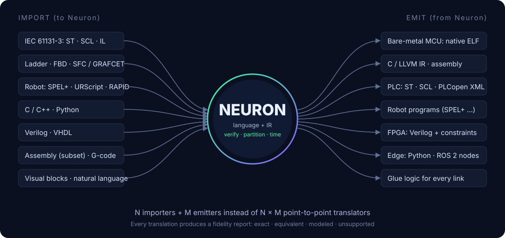
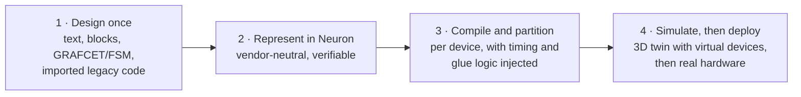
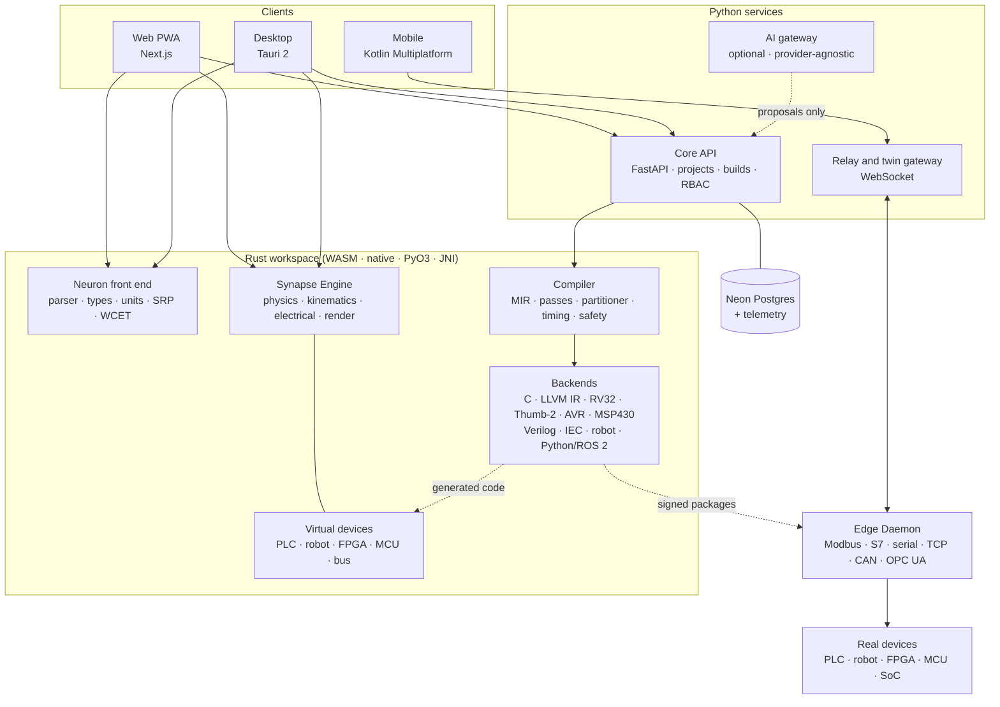
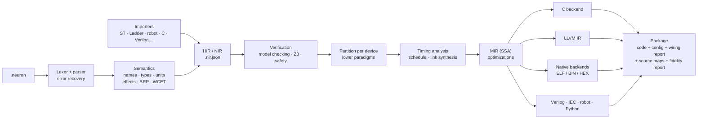
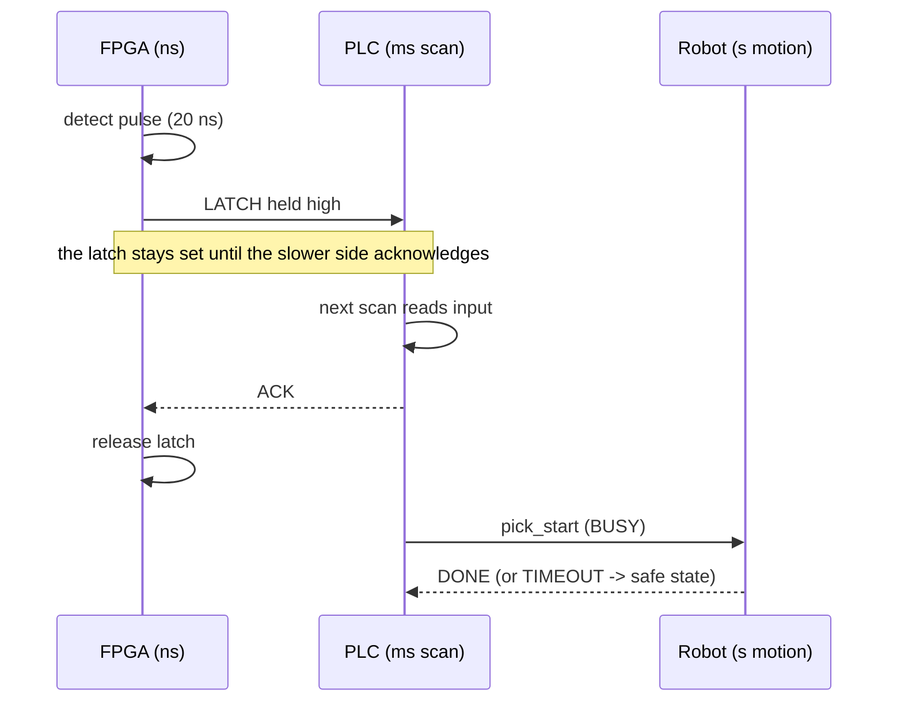
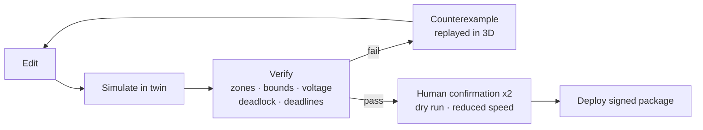
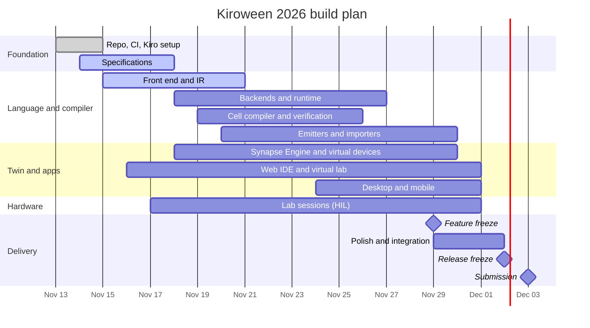

<p align="center">
  
</p>

<p align="center">
  <a href="https://github.com/HCHAPS404/Synapse-Studio/actions/workflows/ci.yml"></a>
  <a href="LICENSE"></a>
  
  
  
  
</p>

<p align="center">
  <b>Design once. Simulate in 3D. Compile to any machine.</b>
</p>

---

> **Project status: early development.** SYNAPSE Studio is being built in public
> during the Kiroween 2026 submission period (30 October to 4 December 2026). This
> README describes the full design. The [Status and roadmap](#status-and-roadmap)
> section states exactly what works today and what is planned. Nothing below marked
> *Planned* should be read as an existing feature.

## Table of contents

- [What is SYNAPSE Studio?](#what-is-synapse-studio)
- [The problem](#the-problem)
- [The solution: one language, many targets](#the-solution-one-language-many-targets)
- [Neuron, the language](#neuron-the-language)
- [Architecture](#architecture)
- [The compiler pipeline](#the-compiler-pipeline)
- [The Standard Time Model](#the-standard-time-model)
- [Safety and verification](#safety-and-verification)
- [Synapse Engine and the digital twin](#synapse-engine-and-the-digital-twin)
- [Virtual lab for judges (no hardware needed)](#virtual-lab-for-judges-no-hardware-needed)
- [Supported devices](#supported-devices)
- [AI: optional, never in the safety path](#ai-optional-never-in-the-safety-path)
- [Client applications](#client-applications)
- [Technology stack](#technology-stack)
- [Repository layout](#repository-layout)
- [Getting started](#getting-started)
- [How we build with Kiro](#how-we-build-with-kiro)
- [Status and roadmap](#status-and-roadmap)
- [Contributing](#contributing)
- [Safety notice](#safety-notice)
- [License and trademarks](#license-and-trademarks)

## What is SYNAPSE Studio?

SYNAPSE Studio is a software-defined industrial automation framework. Its center is
**Neuron**, a new programming language and canonical intermediate representation (IR).

With Neuron you write the logic of a machine, or of a whole manufacturing cell, once.
SYNAPSE Studio then:

1. **Compiles it directly to devices.** It produces native firmware for
   microcontrollers, without an RTOS and without vendor IDEs in the loop.
2. **Translates between ecosystems.** It imports existing PLC, robot, HDL, C and
   Python code into Neuron and emits the native language of each target device.
3. **Verifies before anything is energized.** It checks shared-zone exclusion, robot
   workspace bounds, voltage compatibility, timing budgets and state-machine
   properties.
4. **Simulates everything in a digital twin.** The twin is a from-scratch 3D engine
   whose virtual PLCs, robots, FPGAs and MCUs run the *generated code itself*.
5. **Deploys to real hardware** through a local Edge Daemon. Cells can be supervised
   from web, desktop and mobile apps.

## The problem

A real manufacturing cell or university lab rarely comes from a single vendor. One
line can combine a PLC from one brand, a pneumatic bench driven by a PLC from
another, a 6-axis robot arm, FPGA boards for high-speed logic and microcontrollers
for monitoring. Integrating them has five recurring costs:

| Barrier | What it means in practice |
|---|---|
| **Fragmented tools and languages** | Engineers juggle more than eight proprietary environments and languages (Ladder/SCL, Structured Text, robot languages, Verilog/VHDL, C/C++, Python/ROS). |
| **Hand-written glue logic** | Much of the integration time goes into mapping Modbus registers, PLC data blocks, TCP sockets and UART frames, just so two machines from different vendors can exchange a confirmation signal. |
| **Clashing time domains** | An FPGA switches in nanoseconds, a PLC scans in milliseconds, and a robot finishes a trajectory in seconds. Without formal hold-and-acknowledge mechanisms, fast pulses are lost. |
| **Physical and electrical risk** | Independent programs are not cross-checked, so collisions in shared zones are possible. Wiring 3.3 V logic to 24 V industrial I/O can destroy boards. |
| **Vendor lock-in and cost** | Closed, expensive or discontinued software keeps small companies and labs from modernizing machinery that still works. |

## The solution: one language, many targets

<p align="center">
  
</p>

The workflow has four stages:



**Example.** Consider this rule: *"when the optical sensor detects a bottle, run the
capping cycle, move the part with the robot to the press and fire the pneumatic
cylinder."* You write it once. From that single source, SYNAPSE Studio generates:
- the PLC program for the capping station,
- the robot program,
- the Structured Text for the pneumatics PLC,
- the Verilog or C++ for the FPGA or microcontroller,
- the synchronization messages between all of them.

Neuron supports two kinds of translation:

- **Porting logic.** The same program moves to another host, for example from one
  MCU to another, or from Ladder to Structured Text.
- **Bridging master and slave.** "Control the robot from the FPGA" does not mean
  turning robot code into Verilog. Neuron emits an FPGA master program and a robot-side
  command interpreter, joined by a verified link.

Every import and emission produces a **fidelity report** that lists what translated
exactly, what was approximated and what has no equivalent on the target.

## Neuron, the language

Neuron is a full programming language as well as an IR. It has two levels in one
syntax:

- **`module` (code level):** the program of a single device, down to bare-metal
  microcontrollers.
- **`cell` (system level):** devices, links, shared zones, sequences and safety rules
  for a whole cell.

> The syntax below is the **edition 2026 draft** defined in the
> [language specification](spec/language/README.md) (v0.4). It is not frozen yet.
> Both programs are copied from [`examples/`](examples/), which CI analyzes on every
> commit.

**A PID thermostat on a bare-metal MCU** ([`examples/thermostat.neuron`](examples/thermostat.neuron))

```python
module thermostat for mcu on nucleo_f446re

use std.control.{pid, lowpass}

const target = 60 degC

io sensor: adc(resolution: 12)  @ ADC1.in0(PA0)
io heater: pwm(freq: 1 kHz)     @ TIM2.ch2(PA1)
io alarm:  gpio.output          @ PA5

signal temp: f32 degC

let filter = lowpass(cutoff: 2 Hz)
var ctl = pid(kp: 2.0, ki: 0.1, out: 0..100 %, antiwindup: true)

task measure every 10 ms (prio 3):
  temp = sensor.read() |> scale(0..4095 -> 0..120 degC) |> filter.step()

task control every 100 ms (prio 2, deadline 20 ms):
  heater.duty = ctl.step(target - temp)

safety:
  watchdog 50 ms
  safe_state:
    heater.duty = 0 %
    alarm.write(true)
  when temp > 90 degC:
    fault Overheat
```

**A heterogeneous bottling cell** ([`examples/bottling_line.neuron`](examples/bottling_line.neuron))

```python
cell BottlingLine
  device ctl:  nucleo_f446re          @ usb
  device plc:  generic_s7_1200        @ ip(192.168.0.10)
  device arm:  generic_scara          @ ip(192.168.0.20)
  device fpga: generic_artix7_board   @ uart(COM4, 115200 Bd)

  place thermostat on ctl
  place conveyor on plc

  event bottle_seen: timestamp, encoder: u32 from fpga

  link fpga.bottle  -> plc.sensor  via zero_hop(gpio, opto_24v) within 15 ms
  link plc.cap_done -> arm.pick    via modbus_tcp every 10 ms within 25 ms

  tag line_speed: f32 mm/s @ plc.%MD20, ctl.speed

  zone press: box(x: 100..220 mm, y: -40..40 mm, z: 0..120 mm)
  mutex press between arm, plc.press_cylinder

  sequence Cycle on plc:
    initial step Idle:
      until plc.sensor.rising
    step Cap:
      run plc.capper.cycle()
      until plc.capper.done timeout 3 s -> Fault
    step Move:
      run arm.pick_and_place(from: conveyor_track(bottle_seen), to: press)
      until arm.done timeout 5 s -> Fault
      -> Idle
    step Fault:
      fault CycleFault
```

<sub>Code blocks use Python highlighting only because GitHub has no Neuron grammar
yet. A TextMate grammar and a VS Code extension are planned.</sub>

### Design principles

| Area | Decision |
|---|---|
| **Syntax** | New, indentation-based and readable. Pipelines `\|>`, arrows `->`, placement `@`, ranges `a..b`, named arguments. Not a copy of C, Rust or Python. |
| **Physical units** | Units are part of the type system (`5 ms`, `24 V`, `120 mm`, `60 degC`). `mm + ms` is a compile error (`NE0201`). |
| **Memory** | Static by default. No garbage collector and no implicit heap. `pool<T, N>` for fixed-capacity allocation. Stack depth is computed per task. |
| **References** | No raw pointers. Shared-read or exclusive-write references, checked at compile time. |
| **Concurrency** | Periodic, event and interrupt tasks with static priorities. The Stack Resource Policy (priority ceiling) guarantees no data races and no deadlocks. |
| **Real time** | Bounded loops. WCET (worst-case execution time) is estimated per task and checked against its declared `deadline`. |
| **Reactive constructs** | `fsm`, `sequence` (GRAFCET/SFC), `when … for 200 ms`, `every 10 ms`, `on event`. Async actions expose BUSY/DONE/TIMEOUT. |
| **Hardware** | Typed registers generated from CMSIS-SVD, per-architecture `asm` blocks and `extern "C"`. |
| **Abstraction** | `struct`, `enum` with payloads, `class` (also IEC function blocks), interfaces, static-dispatch generics, `Option`/`Result` (no exceptions). |
| **Contracts** | `requires`, `ensures`, `invariant` and `deadline`, checked by the verifier. |
| **Dialects** | `core`, `mcu`, `plc`, `hdl`, `robot`, `ui`, `host` and `cell`, declared in each file header. Each dialect restricts the legal constructs and explains why (`NE0501`). |

### File formats

| File | Purpose |
|---|---|
| `.neuron` | Source code, written by people and versioned in git. |
| `.nir.json` | Canonical IR for interchange between tools ([spec chapter 16](spec/language/16-nir.md)). Validated with the JSON Schema [`spec/schemas/nir.schema.json`](spec/schemas/nir.schema.json). |
| `.layout.json` | Diagram positions, kept separate so moving a block does not touch the logic diff. |
| `.scene.json` | Digital-twin scene. |
| `.target` | Architecture and board description (ISA, ABI, memory map, peripherals). |
| `neuron.toml` / `neuron.lock` | Package manifest and lockfile. |

### Standard library (planned)

`core` · `units` · `hal` · `logic` (IEC timers, counters, edge detection, GRAFCET runtime) ·
`control` (PID, IIR/FIR/Kalman filters, ramps, hysteresis) · `motion` (kinematics,
interpolators, stepper/servo profiles, G-code) · `proto` (Modbus RTU/TCP, CAN/CANopen,
MQTT, CRC, CBOR, SCPI, minimal OPC UA) · `dsp` · `drivers` (IMUs, temperature, load
cells, displays, encoders and more) · `safety` · `time` · `diag` · `test` · `bsp`.

## Architecture



The architecture separates two planes:
- **Supervision plane:** web, desktop and mobile apps connected by WebSockets.
- **Control plane:** deterministic and local. Once deployed, logic runs inside each
  device. If a tablet turns off or Wi-Fi drops, the cell keeps operating safely.

When two nearby devices need a microsecond response, the compiler can assign a
**zero-hop** link (GPIO, UART or CAN) so the signal does not pass through a computer.

## The compiler pipeline



Device code has three backend tiers:

1. **C backend.** Portable, uses each vendor toolchain. Covers every MCU from day one.
2. **LLVM IR backend** (textual), compiled with `clang`/`llc`/`lld`.
3. **Native backends with no external dependencies.** Instruction selection, register
   allocation, assembler and linker, for RV32IMC, ARM Thumb-2, AVR and MSP430.

Each generated line keeps a **source map** back to its `.neuron` line and diagram
element. This is what lets the inspector highlight the running line during
simulation.

## The Standard Time Model

Devices that work together must agree on time. Neuron defines one time model for the
whole cell:



- **Cell clock:** a base tick with per-domain multiples (ns FPGA, µs MCU/ISR,
  ms PLC and buses, s robot).
- **Logical execution time (LET):** inputs are sampled at the start of a period and
  outputs published at its end, so results do not depend on execution jitter.
- **Compiled schedule:** the compiler synthesizes a cyclic schedule for exchanges
  between devices.
- **Async actions** are wrapped with BUSY/DONE/TIMEOUT. Fast-to-slow crossings get
  Latch+ACK automatically.
- **Worst-case latency analysis:** serialization + transport + scan phase + polling
  interval. If a link cannot meet its `within` budget, the compiler rejects it and
  suggests a zero-hop link, buffering or a different period.
- **Calibration:** measurements from the Edge Daemon calibrate the model, and the
  twin injects the same latency and jitter.

## Safety and verification



| Check | What it prevents |
|---|---|
| **Mutex zones** (compile-time) | A robot entering a shared volume while an actuator is active. Interlocks are injected on both sides. |
| **Workspace bounds** | Every robot target coordinate is checked against a safe bounding box before the motion command is emitted. |
| **Electrical topology** | Wiring incompatible logic levels (3.3 V TTL vs 24 V DC). Suggests optocouplers or level shifters. |
| **Watchdogs and E-STOP** | If a node loses communication for more than 50 ms, or the global E-STOP is pressed, every controller goes to its declared safe state. |
| **Model checking + SMT (Z3)** | Deadlock, unreachable states, mutual exclusion violations, missed deadlines and resource conflicts, each with a reproducible counterexample. |
| **Safe commissioning** | Deployment is blocked until simulation and verification pass, followed by two human confirmations, a dry run and reduced speed. |

Remote control uses TLS, mutual authentication, signed packages, a command allowlist,
role-based access control and an audit log.

## Synapse Engine and the digital twin

The Synapse Engine is written **from scratch in Rust** and compiled to WebAssembly
(browser), native code (desktop) and JNI (Android).

| Subsystem | Model |
|---|---|
| **Kernel** | Deterministic fixed step, fixed evaluation order and a seeded RNG. Snapshots support pause, step, slow motion and **rewind**. |
| **Rigid bodies** | Own contact solver with friction. Conveyors use surface velocity. Grippers: vacuum and parallel. A mature solver is used only as a test oracle for differential testing. |
| **Kinematics** | 6-axis and SCARA arms: forward kinematics, analytic and damped numerical IK, trapezoidal and S-curve profiles, point-to-point, linear and arc moves, singularity detection, swept volumes. |
| **Electrical** | Modified nodal analysis: R, C, L, diodes and piecewise switches. Reports per-pin current and effective logic levels. Rule-based, not a full SPICE engine. |
| **Pneumatics and drives** | Cylinders with mass and pressure, valves as orifices, reed sensors. DC, stepper and servo motors with PID and encoder quantization. |
| **Sensors** | Optical (ray cast), inductive, light barrier, ADC with noise and drift. |
| **Links** | Latency, jitter, loss and reordering per link, with the same model as the compiler. |
| **Rendering** | `wgpu` (WebGPU with a WebGL2 fallback): PBR, shadows, instancing, gizmos, overlays for zones, trajectories, signals and latency. glTF/URDF assets and video capture. |

### Virtual devices run the generated code

The twin does not animate the abstract logic. Each virtual device **executes the code
SYNAPSE Studio generated for it**:

| Virtual device | Executes |
|---|---|
| Virtual PLC | Full Structured Text and the SCL subset we emit, with a configurable 5–20 ms scan cycle and simulated Modbus/S7 servers. |
| Virtual robot controller | The core of the robot language we emit, driving the engine's kinematics. |
| Virtual FPGA | Event-driven RTL simulation of the synthesizable Verilog subset (IEEE 1364.1), clocks of 50–100 MHz. |
| Virtual MCU | Instruction-set simulators (RV32, Thumb-2, AVR, MSP430) running the **real firmware binary**, with peripherals generated from SVD. |
| Virtual bus | UART, GPIO, Modbus, CAN and TCP with the Standard Time Model. |

Every virtual device displays a **fidelity badge**, so you always know what is real
and what is modeled:

| Badge | Meaning |
|---|---|
| **Exact** | Runs the code Neuron generated. |
| **Equivalent** | Runs imported code after it was re-emitted through Neuron. |
| **Modeled** | Black box with a declared contract (marked "not verified"). |
| **Replay** | A recorded trace from a real lab session. |

Correctness is checked by differential testing against established open-source tools
(Structured Text compilers and runtimes, Verilog simulators) using random programs
generated from the grammar.

## Virtual lab for judges (no hardware needed)

The whole product works **without any physical machinery**:

- A **"Try the virtual lab"** button with no account.
- The main flow (edit → compile → simulate → inspect code → inject faults → E-STOP)
  runs entirely in the browser (WASM) and also offline as a PWA.
- Ready-made scenarios:
  - **A:** the full bottling cell.
  - **B:** legacy Ladder importing.
  - **C:** robot program with an FPGA master.
  - **D:** bare-metal STM32 with step-by-step debugging.
  - A free builder for custom scenes.
- A guided 3-minute tour with fault injection (jam, PLC disconnect, light barrier,
  E-STOP).
- A **"Live hardware: online/offline"** indicator. When the lab is offline the twin
  takes over. When it is online, mixed real/virtual mode is available.
- Recorded real lab sessions replayed on top of the twin.
- Three availability layers: static site on a CDN, a backend copy on Render, and an
  offline package (`docker run` or the desktop installer).

## Supported devices

The framework is **universal by design**. A new device is a JSON manifest plus a
`.target` description. The core compiler does not change.

| Family | Examples | Output | Link and domain |
|---|---|---|---|
| Industrial PLC | Siemens S7-class, Yaskawa, Schneider, Allen-Bradley | SCL / ST / PLCopen XML | S7, Modbus TCP (ms · 24 V DC) |
| PLC + pneumatics | Yaskawa PLC with Festo-class valves and cylinders | Structured Text (IEC 61131-3) | Modbus TCP / industrial I/O |
| Industrial robot | 6-axis and SCARA arms (e.g. Epson-class) | Robot program (SPEL+ and others) | TCP/IP socket |
| FPGA | Xilinx Artix-7 / Spartan class | Synthesizable Verilog + XDC/PCF | UART / GPIO (ns · 3.3 V) |
| MCU (bare metal) | STMicroelectronics STM32, Texas Instruments MSP430/MSPM0/Tiva, Arduino AVR and Cortex-M, Raspberry Pi Pico (RP2040/RP2350), ESP32 | Native ELF/BIN/HEX, C, LLVM IR | UART, MQTT, CAN (µs/ms · 3.3 V) |
| Edge SoC | Raspberry Pi, NVIDIA Jetson | Python / ROS 2 nodes | Ethernet, WebSockets, ROS 2 |

Manifests are generated from **machine-readable sources** whenever possible (CMSIS-SVD,
pin databases, FPGA package files, EDS, GSDML, ESI, IODD, URDF). AI only fills gaps.
Manifests carry a trust level (verified, community, AI-generated and unreviewed), and
unreviewed manifests cannot deploy to hardware.

**Topologies:** one device; several devices of the same type from different vendors
(interchangeable by capability class); replicas in parallel (redundancy, 2oo3 voting);
and fully heterogeneous cells. The block palette for each device shows only what that
device can actually do. For example, an 8-bit board does not offer peripherals it does
not have, and the UI explains why.

## AI: optional, never in the safety path

| Mode | What it does |
|---|---|
| **Classic** (default) | No AI at all. You program in Neuron or with visual blocks. |
| **Assistant** | An agent with restricted tools (schema, validator, block catalogue). It *proposes* changes; you accept them, and the verifier checks them. |
| **Bring your own model** | A local model or your own API key. Keys are encrypted on the client and never logged. |

Everything an AI produces goes through the same schema validation, verifier and safety
checks as human-written code.

## Client applications

| App | Stack | Role |
|---|---|---|
| **Web** | Next.js PWA, WASM compiler and engine | Full IDE, cell designer, chip and pin view, synchronized editors (text, blocks, GRAFCET/FSM, Ladder), inspectors and virtual lab |
| **Desktop** | Tauri 2 (decision gate vs Qt on 2026-11-24) | Everything in the web app plus USB/serial flashing, local toolchains and an embedded Edge Daemon |
| **Mobile** | Kotlin Multiplatform + Compose (Android first) | Remote control: live telemetry, scenarios, settings, supplementary E-STOP, 3D viewer |

## Technology stack

| Layer | Technologies |
|---|---|
| Language, compiler, engine, virtual devices | Rust (workspace), WebAssembly, PyO3, JNI |
| Core API and Edge Daemon | Python 3.12, FastAPI, Pydantic v2, SQLAlchemy 2, Alembic, pymodbus, python-snap7, pyserial, asyncua |
| Web | Next.js, React, TypeScript (strict), Tailwind, shadcn/ui, Monaco, dockview, Serwist |
| Desktop / mobile | Tauri 2 / Kotlin Multiplatform + Compose Multiplatform |
| Data | Neon Postgres (TimescaleDB for telemetry), SQLite/Parquet on the daemon |
| Infrastructure | Render (always-on backend), Vercel (web), GitHub Actions, Docker |
| Quality | proptest, Hypothesis, fast-check, pytest, Playwright, golden files, differential testing |

## Repository layout

```
.kiro/        Kiro specs, steering, hooks, agents and MCP settings
crates/       Rust workspace: Neuron language, compiler, backends, engine
lib/          Neuron standard library (written in Neuron)
services/     Core API (FastAPI) and Edge Daemon (Python)
apps/         Web (Next.js PWA), desktop (Tauri), mobile (Kotlin Multiplatform)
packages/     Shared TypeScript packages
spec/         Language and format specifications, JSON Schemas
conformance/  Golden files and conformance vectors
devices/      Device manifests and board profiles
targets/      Architecture and MCU target descriptions
scenes/       Digital-twin scenes
examples/     Neuron example programs
docs/         Decisions, guides, compliance, Kiro usage log
tools/        Repository tooling scripts
```

Folders that do not exist yet are created by their plan tasks.

## Getting started

**Prerequisites:** Git, Rust (stable), Python 3.12+, [uv](https://docs.astral.sh/uv/),
Node.js 24+ and pnpm (for the web app, later), and Docker (optional).

```bash
git clone https://github.com/HCHAPS404/Synapse-Studio.git
cd Synapse-Studio

# Rust workspace (language and CLI)
cargo test --workspace
cargo run -p neuron-cli -- --version
cargo run -p neuron-cli -- check examples --report --cpu-hz 16000000 --ram 2048
cargo run -p neuron-cli -- emit-nir examples -o target/examples.nir.json   # canonical IR
cargo run -p neuron-cli -- print-nir target/examples.nir.json              # IR back to source
cargo run -p neuron-cli -- run examples/thermostat.neuron --for 1s         # run in simulated time

# Core API
cd services/core
uv sync
uv run pytest
uv run uvicorn synapse_core.main:app --reload
# then open http://127.0.0.1:8000/health and http://127.0.0.1:8000/docs
```

On Windows, `tools/verify-local.ps1` runs every check (Kiro guard, `cargo fmt`,
`clippy`, Rust tests, `ruff`, `pytest`) and writes a summary to `out/verify.log`.

## How we build with Kiro

SYNAPSE Studio is built spec-first with [Kiro](https://kiro.dev). Everything is in
[`.kiro/`](.kiro/), and each step is logged in [`docs/kiro-log.md`](docs/kiro-log.md).

| Kiro feature | How we use it |
|---|---|
| **Specs** | Requirements → design → tasks for every component, with **correctness properties** (units, formatter idempotence, IR round-trip, SRP race freedom) that become property-based tests. Specs so far: [`neuron-language`](.kiro/specs/neuron-language/), [`neuron-sema`](.kiro/specs/neuron-sema/), [`neuron-nir`](.kiro/specs/neuron-nir/). |
| **Steering** | Always-on: product, tech, structure and conventions. Loaded by file pattern: Rust, Python and TypeScript style, plus **code-generation safety rules** (synchronous HDL with no latches, non-blocking C, robot workspace checks, IEC conventions). |
| **Agent hooks** | `cargo check` on save, a guard that fails if `.kiro` is ever gitignored, and evidence logging after each spec task. Secret scanning runs in CI (gitleaks). |
| **MCP** | *Planned:* a datasheet and register-map server for the AI Driver Builder, plus GitHub, Playwright and Neon integrations. |
| **Custom agents** | *Planned:* `spec-reviewer`, `safety-auditor`, `emitter-author`, `manifest-builder`. |
| **Property-based testing** | proptest (Rust) and Hypothesis (Python) from the first commit. |
| **Kiro Crew** | *Planned:* parallel workers and a separate Crew app. |

## Status and roadmap

**Legend:** ✅ done · 🚧 in progress · 📋 planned

| Area | Status |
|---|---|
| Repository, license, governance, CI (compliance, Rust, Python) | ✅ |
| Kiro steering and hooks | ✅ |
| Core API skeleton with `/health` | ✅ |
| Neuron language specification (edition 2026) | 🚧 draft v0.5 (17 chapters) |
| Lexer, parser | ✅ |
| Formatter | 📋 |
| Names, modules and packages; types and units; dialect rules | ✅ (`neuron check`) |
| SRP ceilings, response-time analysis, memory budget | ✅ (abstract cost model; target timing in B1) |
| Safe-state checks and model checking of state machines and sequences | ✅ (counterexample traces) |
| NIR (canonical IR): JSON Schema, printer back to source, round-trip property | ✅ (`neuron emit-nir`, `neuron print-nir`) |
| Reference interpreter: simulated time, LET signals, safe state, `test` blocks | ✅ (`neuron run`, `neuron test`) |
| Conformance vectors | 📋 |
| Device manifests, resource solver, topologies | 📋 |
| C backend and runtime, LLVM IR, native backends (RV32, Thumb-2, AVR, MSP430) | 📋 |
| ISA simulators, virtual MCU, debugger | 📋 |
| Standard library | 📋 |
| Partitioner, timing analysis, safety verifier, model checking | 📋 |
| Emitters (Verilog, IEC, robot, Python/ROS 2) and importers | 📋 |
| Edge Daemon and hardware-in-the-loop | 📋 |
| Synapse Engine and virtual devices | 📋 |
| Web IDE and virtual lab | 📋 |
| AI assistant and AI Driver Builder | 📋 |
| Desktop and mobile apps | 📋 |



## Contributing

See [`CONTRIBUTING.md`](CONTRIBUTING.md). In short:
- Spec first.
- Use Conventional Commits with a DCO sign-off (`git commit -s`).
- Open PRs against `develop`.
- Never commit secrets, and never gitignore `.kiro`.

Security reports: [`SECURITY.md`](SECURITY.md).

## Safety notice

SYNAPSE Studio is an engineering **design aid**. It is **not** a safety-certified tool
and does not claim compliance with IEC 61508 or ISO 13849. A hardwired emergency stop
is always the authority; the software E-STOP is supplementary. Never run generated
code on real machinery without independent validation, dry runs and reduced-speed
commissioning.

## License and trademarks

Licensed under the [Apache License 2.0](LICENSE). See [`NOTICE`](NOTICE).

Vendor and product names (PLC, robot, FPGA and microcontroller brands) are trademarks
of their respective owners. They appear here only to describe compatibility. This
project is not affiliated with, endorsed by or sponsored by those owners.

<p align="center"><sub>Built for Kiroween 2026 · Frankenstein category · by Hell and Martin</sub></p>
